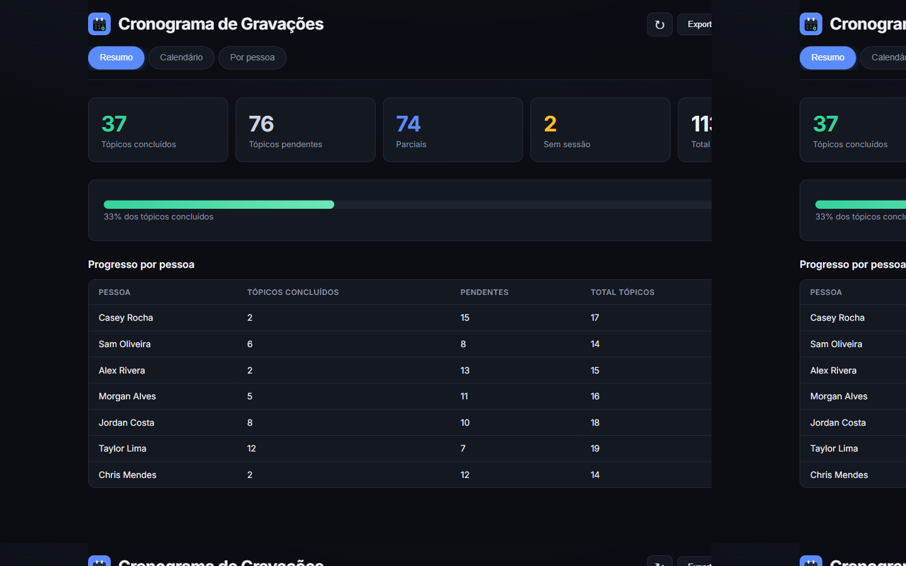
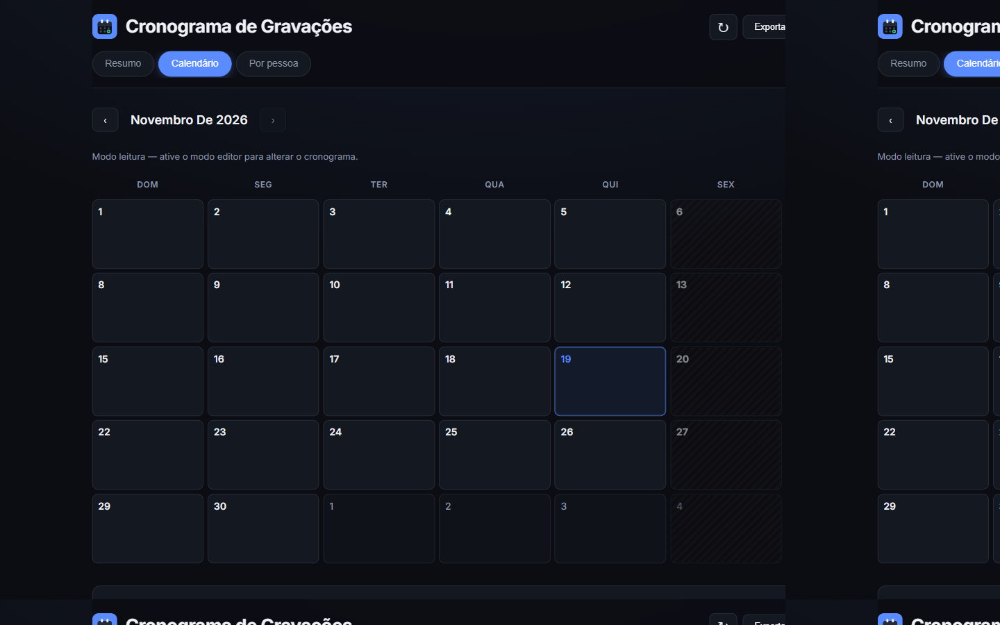
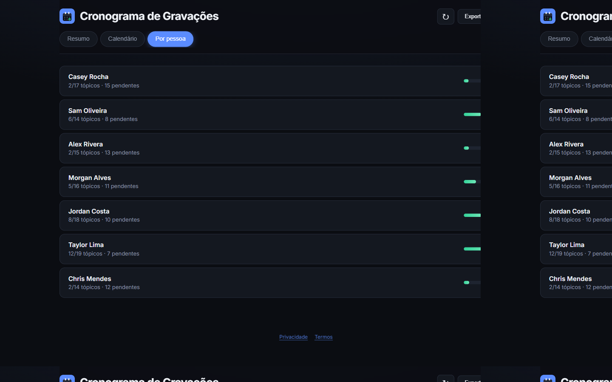

<p align="center">
  <picture>
    <source media="(prefers-color-scheme: dark)" srcset="assets/logos/logo-lockup.svg">
    
  </picture>
</p>

<p align="center">
  <strong>Who records what — on the calendar and by person.</strong><br>
  Internal panel to reschedule, mark as done, and track the team's progress.
</p>

<p align="center">
  
  
  
  
  
</p>

<p align="center">
  
</p>

<p align="center">
  <a href="README.md">🇧🇷 Português</a> · 🇺🇸 English
</p>

## 🤔 The problem

A training schedule in a spreadsheet or chat becomes a wall of text: hard to see who is left, what lands in the month, and what is already recorded. Rescheduling turns into side conversations.

**Recording Schedule** structures that in three tabs — overview, calendar, and by person — with sessions in Supabase and the people catalog in YAML.

## ✨ What only it guarantees

| | |
|---|---|
| 📊 **Overview by topic** | Completed, pending, and partial totals — with a progress bar. |
| 📅 **Calendar with drag** | Reschedule, swap times, and per-session notes in the month. |
| 👤 **Load by person** | Progress by topic, multi-session, and notes indicator. |
| 🔒 **Public read, editor write** | Visitors browse; editors authenticate and confirm the batch before apply. |

## 🧭 How it's used

1. **Open** the panel and check **Overview** (totals and progress by person).
2. Use **Calendar** to reschedule, annotate, or mark sessions.
3. Use **By person** for each teammate's load and remaining topics.

<details>
<summary><strong>📸 See the screens</strong></summary>
<br>

<table>
  <tr>
    <td width="50%"><a href="assets/screenshots/resumo.png"></a><br><sub><b>Overview</b>: totals and progress by person</sub></td>
    <td width="50%"><a href="assets/screenshots/calendario.png"></a><br><sub><b>Calendar</b>: month with sessions and status</sub></td>
  </tr>
  <tr>
    <td width="50%"><a href="assets/screenshots/por-pessoa.png"></a><br><sub><b>By person</b>: load and topics per teammate</sub></td>
    <td width="50%"></td>
  </tr>
</table>

</details>

## 🚀 Run it

**Needs:** Node 22+, Yarn 1, a Supabase project, and the variables from `.env.example`.

```bash
yarn
cp .env.example .env
yarn dev
```

Front at http://localhost:3333 · API at http://localhost:3334. Details: [`docs/ambiente-e-operacao.md`](docs/ambiente-e-operacao.md) · Supabase: [`docs/supabase-setup.md`](docs/supabase-setup.md).

## 🧰 Everyday commands

| Command | What for |
|---|---|
| `yarn dev` | Front (3333) and API (3334) together |
| `yarn build` | Build front + server |
| `yarn start` | Production serve (API + `dist/`) |
| `yarn import` | Regenerate YAMLs from the legacy script |
| `yarn blur-demo` | Scrub names for capture/demo |

## 📚 Documentation

| For | Read |
|---|---|
| Understand the project | [`docs/context.md`](docs/context.md) |
| What the product does | [`docs/especificacao.md`](docs/especificacao.md) |
| Screens and routes | [`docs/frontend.md`](docs/frontend.md) |
| Run and publish | [`docs/ambiente-e-operacao.md`](docs/ambiente-e-operacao.md) · [`docs/deploy-render.md`](docs/deploy-render.md) |
| Editor auth | [`docs/seguranca.md`](docs/seguranca.md) |

## 🔐 Governance

- **Internal** use; private repository (`RafaelHDSV/Cronograma-de-Gravacoes`).
- README captures use **fictitious names** (`yarn blur-demo`).
- Suggestion: skill `logo` for light/dark lockup (title is text-only today).
