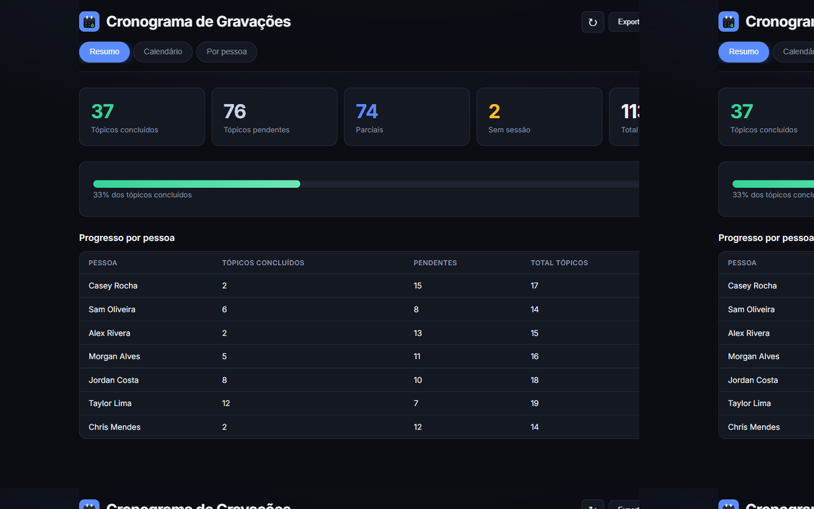
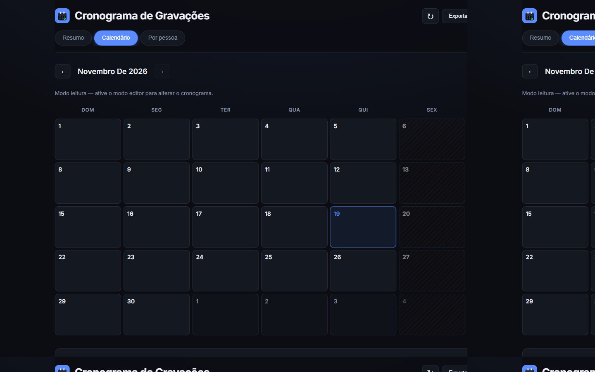
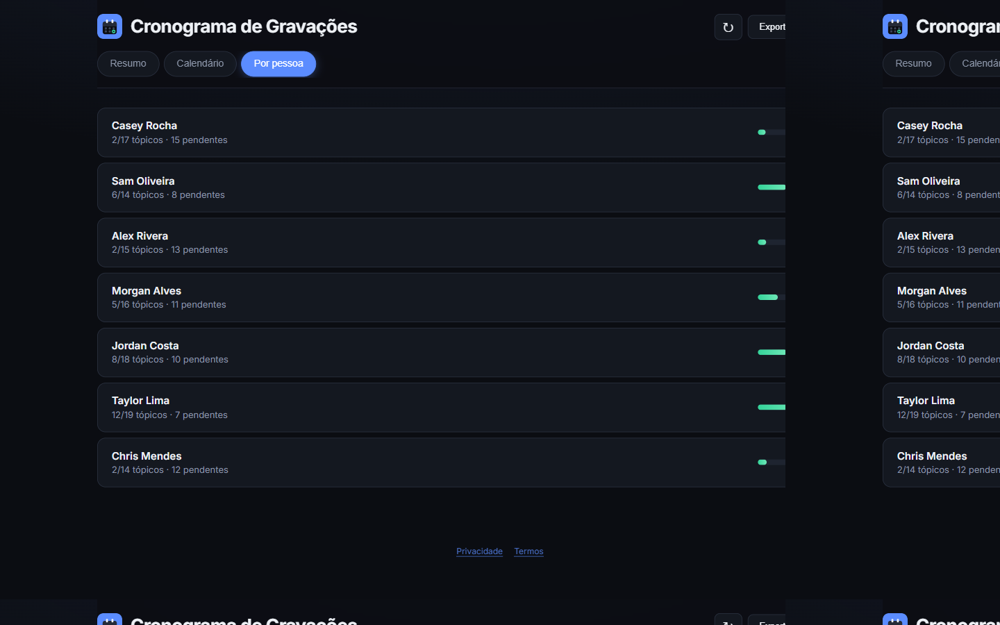

<p align="center">
  <picture>
    <source media="(prefers-color-scheme: dark)" srcset="assets/logos/logo-lockup.svg">
    
  </picture>
</p>

<p align="center">
  <strong>Quem grava o quê — no calendário e por pessoa.</strong><br>
  Painel interno para remarcar, marcar como gravado e acompanhar o progresso da equipe.
</p>

<p align="center">
  
  
  
  
  
</p>

<p align="center">
  
</p>

<p align="center">
  🇧🇷 Português · <a href="README.en.md">🇺🇸 English</a>
</p>

## 🤔 O problema

Cronograma de treinamento em planilha ou chat vira texto corrido: difícil ver quem falta, o que cai no mês e o que já foi gravado. Remarcar e marcar como feito vira conversa paralela.

**Cronograma de Gravações** estrutura isso em três abas — resumo, calendário e por pessoa — com sessões no Supabase e catálogo de pessoas em YAML.

## ✨ O que só ele garante

| | |
|---|---|
| 📊 **Resumo por tópico** | Totais concluídos, pendentes e parciais — com barra de progresso. |
| 📅 **Calendário com drag** | Remarcar, swap de horário e notas por sessão no mês. |
| 👤 **Carga por pessoa** | Progresso por tópico, multi-sessão e indicador de notas. |
| 🔒 **Leitura pública, escrita editor** | Visitante vê; editor autentica e confirma o lote antes de aplicar. |

## 🧭 Como usar

1. **Abrir** o painel e olhar o **Resumo** (totais e progresso por pessoa).
2. **Calendário** para remarcar, anotar ou marcar sessões.
3. **Por pessoa** para ver a carga e o restante de cada integrante.

<details>
<summary><strong>📸 Ver as telas</strong></summary>
<br>

<table>
  <tr>
    <td width="50%"><a href="assets/screenshots/resumo.png"></a><br><sub><b>Resumo</b>: totais e progresso por pessoa</sub></td>
    <td width="50%"><a href="assets/screenshots/calendario.png"></a><br><sub><b>Calendário</b>: mês com sessões e status</sub></td>
  </tr>
  <tr>
    <td width="50%"><a href="assets/screenshots/por-pessoa.png"></a><br><sub><b>Por pessoa</b>: carga e tópicos por integrante</sub></td>
    <td width="50%"></td>
  </tr>
</table>

</details>

## 🚀 Rodar

**Precisa de:** Node 22+, Yarn 1, projeto Supabase e as variáveis do `.env.example`.

```bash
yarn
cp .env.example .env
yarn dev
```

Front em http://localhost:3333 · API em http://localhost:3334. Detalhes: [`docs/ambiente-e-operacao.md`](docs/ambiente-e-operacao.md) · Supabase: [`docs/supabase-setup.md`](docs/supabase-setup.md).

## 🧰 Comandos do dia a dia

| Comando | Para quê |
|---|---|
| `yarn dev` | Front (3333) e API (3334) juntos |
| `yarn build` | Build front + server |
| `yarn start` | Serve produção (API + `dist/`) |
| `yarn import` | Regenera YAMLs do script legado |
| `yarn blur-demo` | Ofusca nomes para captura/demo |

## 📚 Documentação

| Para | Leia |
|---|---|
| Entender o projeto | [`docs/context.md`](docs/context.md) |
| O que o produto faz | [`docs/especificacao.md`](docs/especificacao.md) |
| Telas e rotas | [`docs/frontend.md`](docs/frontend.md) |
| Rodar e publicar | [`docs/ambiente-e-operacao.md`](docs/ambiente-e-operacao.md) · [`docs/deploy-render.md`](docs/deploy-render.md) |
| Auth do editor | [`docs/seguranca.md`](docs/seguranca.md) |

## 🔐 Governança

- Uso **interno**; repositório privado (`RafaelHDSV/Cronograma-de-Gravacoes`).
- Capturas do README usam **nomes fictícios** (`yarn blur-demo`).
- Sugestão: skill `logo` para lockup claro/escuro (hoje o título é texto).
